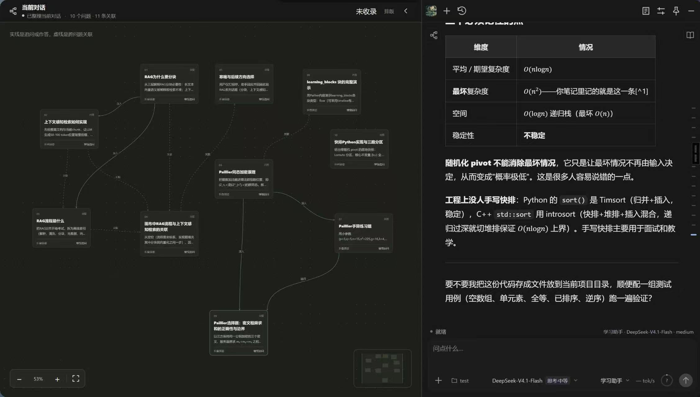
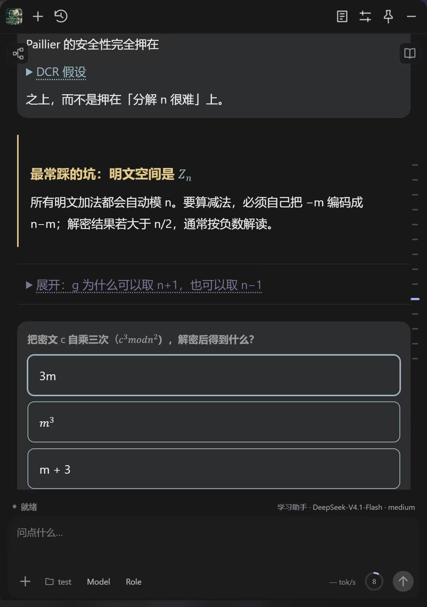
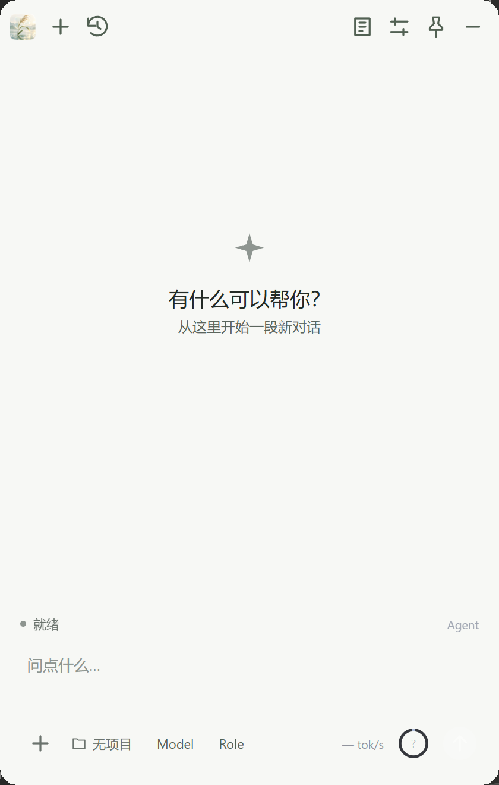
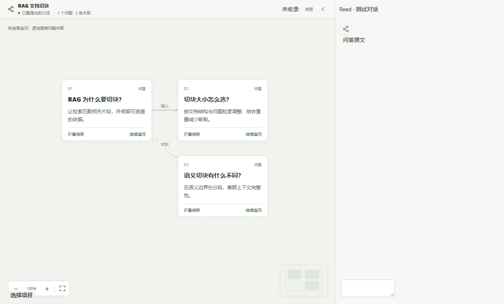
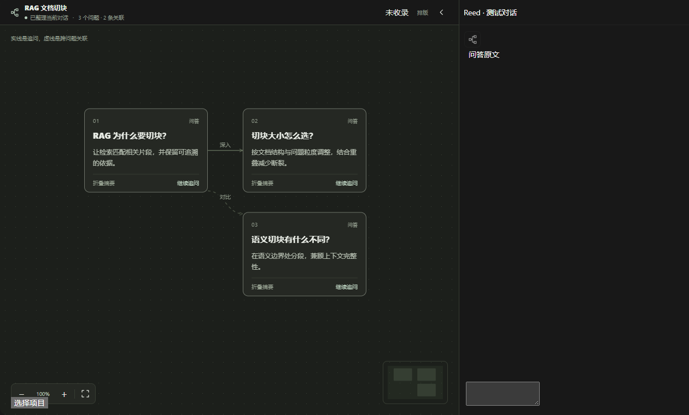

<p align="center">
  
</p>

<h1 align="center">Reed 苇</h1>

<p align="center"><b>一苇以航，轻渡学海。</b><br>
常驻桌面的学习 Agent：讲解、公式、随堂练习都长在对话里，每一轮问答自动整理成能回看、能继续追问的知识地图。</p>

<p align="center">
  <a href="../../releases/latest"></a>
  
  
  <a href="LICENSE"></a>
</p>

> **别的 AI 说完就结束了。Reed 会把它整理成下次还用得上的东西。**

Reed 是面向学习与日常工作的轻量 Windows 桌面 Agent，不是聊天框套壳：会话、笔记库、学习画像、工作经验各有独立的存储与权限，Agent 通过工具去读写，你随时能在界面上看到它把什么记进了哪里。

支持 OpenAI / Anthropic 兼容的任意接口——DeepSeek、OpenRouter 等云端服务，或你自己电脑、另一台电脑上跑的本地模型。模型由你配置，数据留在本机。

## 截图

左边是自动整理的问题卡片与关联，右边是可以继续追问的对话；讲解里的公式、折叠知识点、随堂练习都在正文里直接可用。



<p align="center">
  
</p>

<details>
<summary>浅色主题、主窗口、设置页与图标</summary>

| 主窗口 | 对话画布 |
| --- | --- |
|  |  |

| 画布（深色） | 设置 |
| --- | --- |
|  |  |


</details>

## 为什么值得留着它

- **边讲边练，不用切窗口** — 讲解、公式、对照表、可折叠的推导、选择与填空，全部渲染在回答里；点一个选项就直接继续追问，不会掉进「复制到另一个地方再试一次」的循环。
- **回答会自己长成知识地图** — 每轮问答整理成问题卡片与关联关系，可查看原文、沿节点继续追问、拖动与缩放；手工标题和布局不会被覆盖，按会话保存。
- **它记得你，但不会乱记** — 学习者画像记录目标、概念、误解与复习安排，知识库与工作经验分层保存；写入前先做价值判断，不确定就不记。
- **来源点得回去** — 连上 Obsidian 笔记库后按知识点检索原文，回答里直接引用文件与行号。
- **本地模型也是头等公民** — 本地或另一台电脑上的推理服务可以显式标成「本地」，前台等待默认不设上限，长思考不会因为「等太久」被掐断。

## 0.3.3 更新

- **本地模型不再被时限打断** — 提供商可选「本地模型（含另一台电脑）」：前台无数据超时与单次生成时限默认不限；远程服务保留 90 秒 / 5 分钟两道默认线，两项都能按秒自行填写，`0` 表示不限。仅影响前台对话，后台整理仍有时限。
- **回答更守规矩** — 按 Chat Completions 的终态语义收口：长度、错误、取消优先于正常结束；流式解析遇到半截帧、EOF 与提前结束不会误判，工具调用不重复执行、结果不丢。
- **恢复只做一次** — 连接断开后每轮最多续接一次，保留你设定的思考档位与系统前缀，不会偷偷降级成 low/off。
- **失败就是失败** — 网页写入或参数校验失败会让旧截图与旧评审立即失效，纠正后必须重新验收，「口头完成」不算完成。

## 功能

- **对话画布** — 把一轮轮问答整理成问题卡片与关联关系。可查看原文、沿节点继续追问、拖动与缩放；面板打开期间每轮结束自动增量整理，手工标题和布局不会被覆盖，按会话保存，删除会话时同步清理。
- **学习块（按角色）** — 模型可以在正文里输出讲解、步骤、对照、提示、关键数值与练习；选项绑定成一条真实的用户消息，由模型继续反馈，不是前端自判题。
- **学习模式** — 每个角色独立开关学习目标、学习者画像与对话画布。目标以 Markdown 存在项目里，Agent 只读；画像记录目标、概念、误解与复习安排。
- **笔记库（Obsidian Markdown）** — 连接本地库后手动生成一份导航总览，之后按知识点检索原文并引用文件与行号。
- **分层记忆** — 画像 / 知识库 / 工作经验三层可分别启停。保存前先做价值判断（可靠证据、持久性、复用价值）；工作经验从验证过的工具操作里整理。
- **桌面 Agent 体验** — 全局快捷键唤出、托盘驻留、窗口置顶、深浅主题与图标风格、图片与文件附件、消息定位、排队与引导、上下文压缩、停止看门狗。
- **工具与权限** — 文件读写限制在工作区与只读目录内，写入可要求手动审批；支持浏览器截图、Tavily 联网与按需连接的 MCP，工具能力可在设置里逐项查看。

## 快速开始

1. 下载[最新版本](../../releases/latest)：`Reed-x.y.z-setup.exe` 安装（当前用户，不需要管理员），或解压 `Reed-x.y.z-portable.zip` 直接运行 `Reed.exe`（同目录需保留 `agent/` 与 `runtime/`）。
2. 首次安装可能弹「Windows 已保护你的电脑」：点「更多信息」→「仍要运行」。原因是安装包未做代码签名，不是检测到病毒。
3. 打开设置 → 模型，添加服务地址与 API Key；「模型部署」按实际情况选**远程服务**或**本地模型（含另一台电脑）**，本地部署可以把两个时限留空。
4. 回到主窗口选择模型与思考档位，开始对话。要体验画布：角色设置里打开**学习模式 → 对话画布**，左上入口即可展开。

> 同一时间只运行一个实例。便携版和安装版共用数据目录，两个同时开会因为 WebView2 数据目录被占用而启动失败。

## 使用

| 想做的事 | 操作 |
| --- | --- |
| 换项目 | 左下项目按钮：恢复历史项目最近的会话，或选择其他文件夹 |
| 在新项目开聊 | 历史列表中项目旁的 `＋` |
| 展开画布 / 学习目标 | 左上 / 右上入口（依赖对应角色开关） |
| 只回答不整理 | 保持画布关闭，或对该轮使用「未收录」 |
| 换角色 | 顶部角色按钮，可自定义提示词并绑定技能 |
| 停止当前回答 | 状态栏右侧停止按钮；上游不响应时会先本地恢复输入并如实说明 |

## 数据与权限

- 配置、会话、画布、记忆位于 `%APPDATA%\Reed`；原始笔记始终留在你选定的笔记库，Reed 只在库根目录新建一份总览文件。
- API Key 由当前 Windows 用户加密保存（DPAPI），不写入会话文件。
- 升级前请从托盘退出旧版；升级与卸载默认保留用户数据。
- 画布整理、笔记检索扩词与记忆整理会额外调用你所选的模型，消耗你自己的额度；本地模型则消耗你自己的算力。

## 从源码构建

需要 Node.js 22.19+、Rust stable 工具链、Windows WebView2 运行时。

```powershell
npm ci                 # 顶层构建工具（Tauri CLI）
npm run agent:install  # Agent 侧依赖
npm test               # Agent 全量测试（Node test runner）
npm run build          # 便携包
npm run build:setup    # 安装包
```

| 目录 | 内容 |
| --- | --- |
| `desktop/agent/` | Node.js Agent：PI Agent 会话、工具、记忆、笔记检索、画布整理 |
| `desktop/web/` | 界面：聊天、画布、设置、学习目标 |
| `desktop/src-tauri/` | Rust 原生宿主：窗口、托盘、快捷键、图标、数据目录 |
| `desktop/tools/` | 打包与隔离验收脚本 |

应用内一键更新需要发布签名私钥（`TAURI_SIGNING_PRIVATE_KEY`），未配置时只产出安装包与便携包。

## 已知边界

- 画布整理、笔记扩词、记忆整理的质量取决于所选模型；笔记检索目前是本地 SQLite FTS5 全文检索，未接入向量检索。
- 总览使用正文抽样，不是逐字精读全库。
- 本地模型需要服务端兼容所选协议（OpenAI Chat Completions 或 Anthropic Messages）；「允许并行请求」仍是实验性开关，仅在服务确实支持时开启。
- 安装包未签名，因此 Windows 会提示未知发布者，也没有应用内更新。

## 许可证

原创部分使用 [MIT License](LICENSE)。第三方来源与分发要求见 [NOTICE.md](NOTICE.md)。感谢 PI Agent、Tauri、WebView2 与 Marked。
